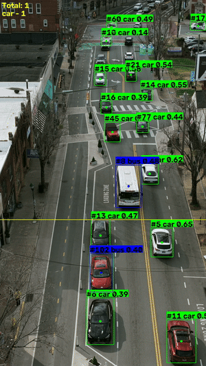

# Contador de veículos com YOLO

Detecta, rastreia e conta os veículos que cruzam uma linha num vídeo de trânsito, separando por tipo (carro, caminhão, ônibus, moto) e por direção. Gera um vídeo anotado e pode ser usado pela linha de comando ou por uma API REST.



## O que ele faz

- **Detecta** veículos em cada frame com o YOLO11 (Ultralytics).
- **Rastreia** cada veículo entre os frames com o ByteTrack, dando a ele um ID.
- **Conta** os veículos que cruzam uma linha horizontal, **por classe** e **por direção** (subindo ou descendo).
- **Gera um vídeo anotado** com as caixas, os IDs, a linha de contagem e um painel com os totais.
- Funciona pela **linha de comando** ou por uma **API REST**, com fila de processamento, acompanhamento do progresso e download do resultado.

## Tecnologias

Python 3.10+, Ultralytics YOLO11, ByteTrack, OpenCV, FastAPI, Pydantic e Uvicorn.

## Instalação

Requer Python 3.10 ou mais recente (desenvolvido e testado no 3.12).

1. Clone o repositório:

   ```bash
   git clone https://github.com/PaladinoMaluko/contador-yolo.git
   cd contador-yolo
   ```

2. Crie e ative um ambiente virtual:

   ```bash
   python3 -m venv .venv
   source .venv/bin/activate
   ```

3. Instale o PyTorch para CPU. Este passo é separado porque a versão padrão do PyTorch vem com suporte a GPU (CUDA) e ocupa vários GB a mais. Se você tem uma GPU NVIDIA, pode pular este passo.

   ```bash
   pip install torch torchvision --index-url https://download.pytorch.org/whl/cpu
   ```

4. Instale as dependências e o projeto:

   ```bash
   pip install -r requirements.txt
   pip install -e .
   ```

Os pesos do modelo (`yolo11n.pt`) são baixados automaticamente na primeira execução.

## Uso pela linha de comando

```bash
contador --entrada videos/transito.mp4 --saida saidas/transito.mp4
```

(`python -m contador` funciona da mesma forma.)

Durante o processamento, o progresso aparece numa única linha. No final, um resumo:

```
Processando: 437/437 (100%)
Total: 11
Classe(s) que foram contadas: bus, car, motorcycle, truck
car - 8
bus - 2
truck - 1
Desceram: 9 | Subiram: 2
```

| Opção | Padrão | Descrição |
|---|---|---|
| `--entrada` | (obrigatória) | Vídeo de origem |
| `--saida` | (obrigatória) | Vídeo anotado a ser gerado (`.mp4` ou `.avi`) |
| `--linha` | `0.6` | Altura da linha de contagem, entre 0 e 1 (0 = topo) |
| `--classes` | todas | Uma ou mais entre `bus`, `car`, `motorcycle` e `truck` |
| `--modelo` | `yolo11n.pt` | Pesos do YOLO |
| `--imgsz` | `480` | Tamanho da imagem na inferência (menor = mais rápido) |

Códigos de saída: `0` sucesso, `1` erro no processamento (vídeo inválido, linha fora do intervalo, extensão não suportada), `2` argumentos inválidos, `130` cancelado com `Ctrl+C`.

## Uso pela API

Suba o servidor a partir da raiz do projeto:

```bash
uvicorn contador.api:app
```

A documentação interativa fica em `http://127.0.0.1:8000/docs`, onde dá para testar todos os endpoints pelo navegador.

O processamento acontece em segundo plano: a API responde na hora, e o cliente acompanha o andamento.

### 1. Enviar o vídeo

```bash
curl -F "arquivo=@videos/transito.mp4" -F "linha=0.6" -F "classes=car" -F "classes=bus" \
  http://127.0.0.1:8000/videos
```

Os campos `linha` e `classes` são opcionais. A resposta (`202 Accepted`) traz o `id` da tarefa e o link para acompanhá-la:

```json
{
  "id": "546b5d1297f444028dabb40a313c0e50",
  "situacao": "na_fila",
  "progresso": 0.0,
  "contagem": null,
  "erro": null,
  "url_video": null,
  "url_status": "http://127.0.0.1:8000/videos/546b5d1297f444028dabb40a313c0e50"
}
```

### 2. Acompanhar o status

```bash
curl http://127.0.0.1:8000/videos/546b5d1297f444028dabb40a313c0e50
```

A `situacao` passa por `na_fila`, `processando` (com o `progresso` de 0 a 1) e termina em `concluido` ou `erro`. Quando concluído, a resposta traz a contagem e o link do vídeo:

```json
{
  "id": "546b5d1297f444028dabb40a313c0e50",
  "situacao": "concluido",
  "progresso": 1.0,
  "contagem": {
    "total": 11,
    "por_classe": {"car": 8, "bus": 2, "truck": 1},
    "por_direcao": {"descendo": 9, "subindo": 2}
  },
  "erro": null,
  "url_video": "http://127.0.0.1:8000/videos/546b5d1297f444028dabb40a313c0e50/anotado",
  "url_status": "http://127.0.0.1:8000/videos/546b5d1297f444028dabb40a313c0e50"
}
```

### 3. Baixar o vídeo anotado

```bash
curl -f -o anotado.mp4 http://127.0.0.1:8000/videos/546b5d1297f444028dabb40a313c0e50/anotado
```

### Endpoints

| Método e caminho | Descrição | Respostas |
|---|---|---|
| `GET /saude` | Indica se a API está no ar | `200` |
| `GET /classes` | Lista as classes que podem ser contadas | `200` |
| `POST /videos` | Envia um vídeo para a fila | `202` aceito, `400` linha ou classe inválida, `413` arquivo acima de 200 MB |
| `GET /videos/{id}` | Situação, progresso e contagem | `200`, `404` tarefa inexistente |
| `GET /videos/{id}/anotado` | Download do vídeo anotado | `200`, `404` inexistente ou com erro, `409` ainda não terminou, `410` não está mais disponível |

## Como funciona

Cada frame do vídeo passa pelo mesmo caminho:

```
frame → YOLO (detecção) → ByteTrack (IDs) → ContadorLinha (contagem) → desenho → vídeo anotado
```

Algumas decisões do projeto:

- **Contagem por travessia, não por presença.** Para cada ID, o contador guarda a posição do frame anterior e só conta quando o centro do veículo passa de um lado da linha para o outro. A direção sai da comparação entre as duas posições.
- **Cada ID é contado uma vez só.** Quando a caixa oscila em cima da linha, o mesmo veículo não é contado de novo.
- **Votação de classe por ID.** O modelo às vezes alterna a classe do mesmo veículo entre frames (uma caminhonete vira "car" e depois "truck"). O contador usa a classe mais frequente daquele ID até o momento.
- **Visual proporcional à resolução.** Fontes, espessuras e o painel são calculados a partir da largura do vídeo, e ficam legíveis tanto em 720p quanto em 4K.
- **Módulos independentes.** Leitura e gravação de vídeo, contagem, desenho e processamento ficam em módulos separados. Os módulos levantam exceções em vez de encerrar o programa, e só os pontos de entrada (linha de comando e API) decidem como mostrar os erros.
- **Fila na API.** Um vídeo é processado por vez, porque o YOLO já ocupa a CPU inteira; os outros esperam na fila. O cliente recebe a resposta na hora e acompanha o progresso pelo status.
- **Segurança nos arquivos.** Os arquivos recebidos são salvos com um nome aleatório (`uuid4`), e do nome enviado só a extensão é aproveitada, o que evita *path traversal*. Mensagens de erro para o cliente não expõem caminhos internos; os detalhes ficam no log do servidor.
- **Limpeza automática.** Vídeos incompletos são apagados quando o processamento falha, e os arquivos de execuções anteriores são removidos quando a API inicia.

Desempenho de referência: um vídeo de 18 segundos em 4K (437 frames) foi processado em cerca de 35 segundos, só com CPU, usando o `yolo11n` com `imgsz=480`.

## Estrutura do projeto

```
contador-yolo/
├── src/contador/
│   ├── __main__.py      # linha de comando (argparse)
│   ├── api.py           # API REST (FastAPI), fila e status das tarefas
│   ├── processador.py   # junta detecção, rastreamento, contagem e desenho
│   ├── contagem.py      # ContadorLinha: travessias por classe e direção
│   ├── desenhar.py      # caixas, rótulos, linha e painel
│   └── video.py         # leitura e gravação de vídeo
├── docs/demo.gif
├── pyproject.toml
└── requirements.txt
```

## Limitações e melhorias futuras

- **Confusão entre classes.** O modelo foi treinado no COCO, que só tem `car`, `truck` e `bus`. Caminhonetes, vans e jipes oscilam entre essas classes. A votação por ID ameniza o problema, e o modelo nano com `imgsz=480` troca precisão por leveza. Melhoria: um modelo maior ou treinado com classes específicas de veículos brasileiros.
- **Troca de ID.** Em oclusões, ou quando a confiança cai, o rastreador pode dar um ID novo ao mesmo veículo, que então pode ser contado duas vezes.
- **Uso de memória em vídeos longos.** O contador guarda a posição e o histórico de cada ID já visto. Melhoria: descartar IDs inativos há muitos frames.
- **Linha só horizontal.** A contagem funciona para vias que atravessam o quadro de cima para baixo. Melhoria: linhas em qualquer ângulo ou regiões poligonais.
- **Vídeo anotado não toca no navegador.** A saída usa o codec `mp4v`, que o VLC reproduz, mas os navegadores não. Melhoria: converter para H.264 com o `ffmpeg` depois do processamento.
- **Tarefas em memória.** Reiniciar a API apaga o status e as contagens, e com vários processos do servidor cada um teria a sua própria lista. Em produção, o estado iria para um banco de dados (SQLite, Redis) e o processamento para uma fila dedicada (Celery, RQ).
- **Tarefas concluídas não expiram.** Enquanto a API está no ar, tarefas e vídeos prontos nunca são removidos. Melhoria: guardar o horário de conclusão e apagar periodicamente o que tiver mais de uma hora.
- **Sem autenticação.** Quem tem o `id` de uma tarefa consegue ver o resultado e baixar o vídeo. Os IDs são aleatórios (`uuid4`), o que impede adivinhá-los, mas vídeos sensíveis exigiriam login por cliente.
- **O limite de 200 MB protege o disco, não a rede.** O arquivo já foi recebido quando é recusado. Em produção, o limite ficaria num proxy na frente da API (por exemplo, o `client_max_body_size` do nginx).

## Créditos

- Detecção e rastreamento: [Ultralytics YOLO](https://github.com/ultralytics/ultralytics) e ByteTrack.

## Licença

Distribuído sob a licença AGPL-3.0, a mesma do Ultralytics YOLO, do qual o projeto depende. Veja o arquivo `LICENSE`.
